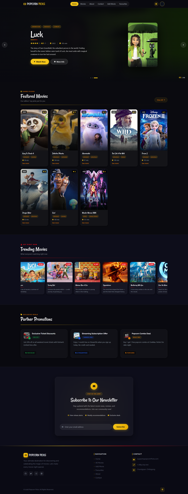
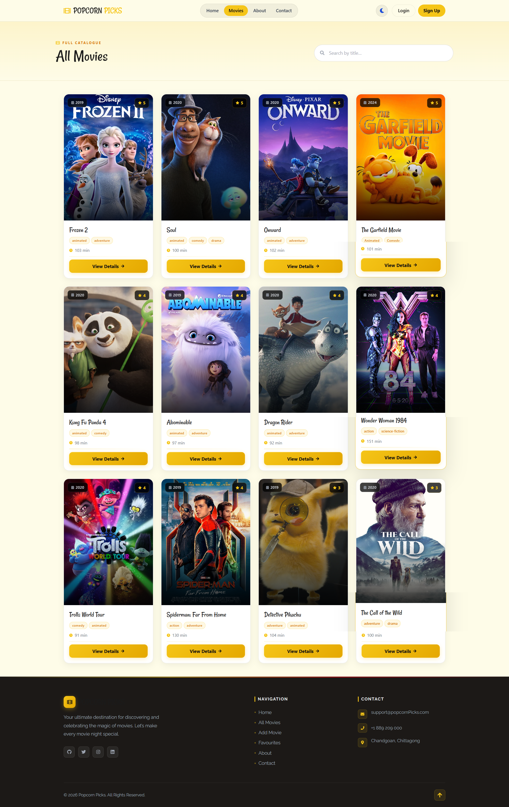
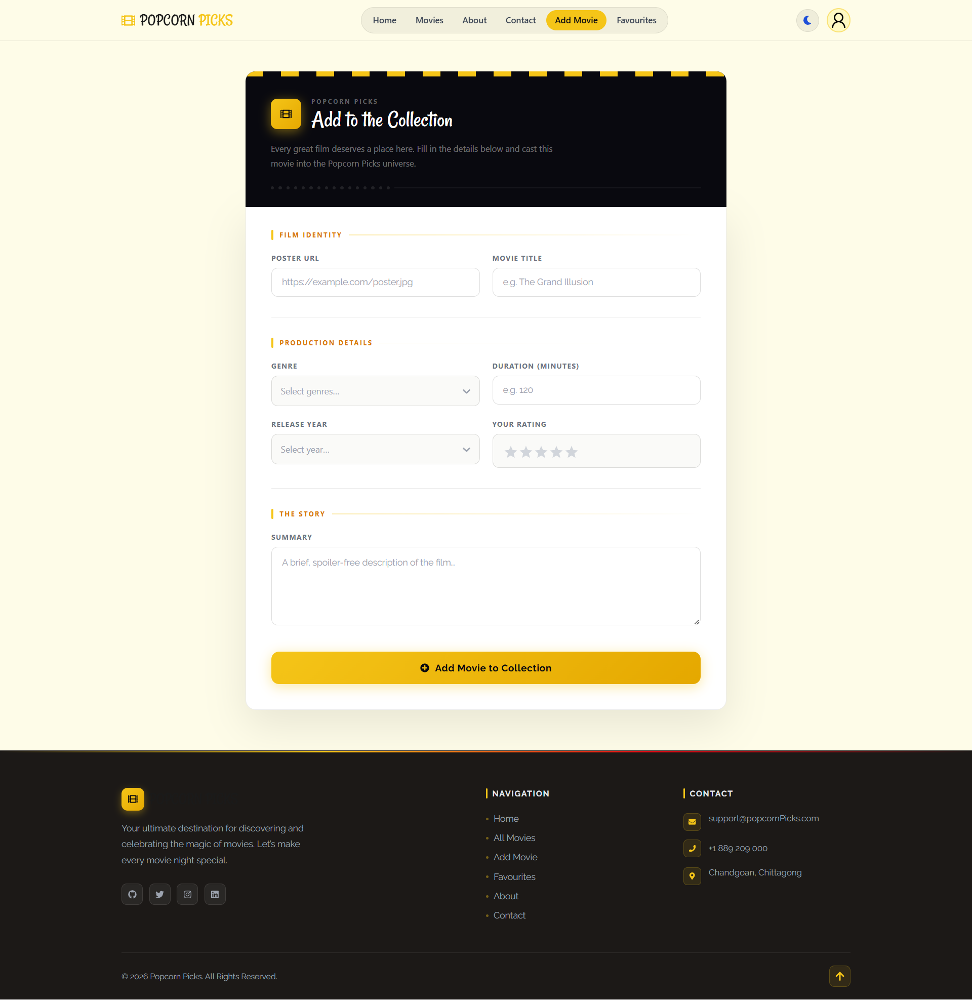
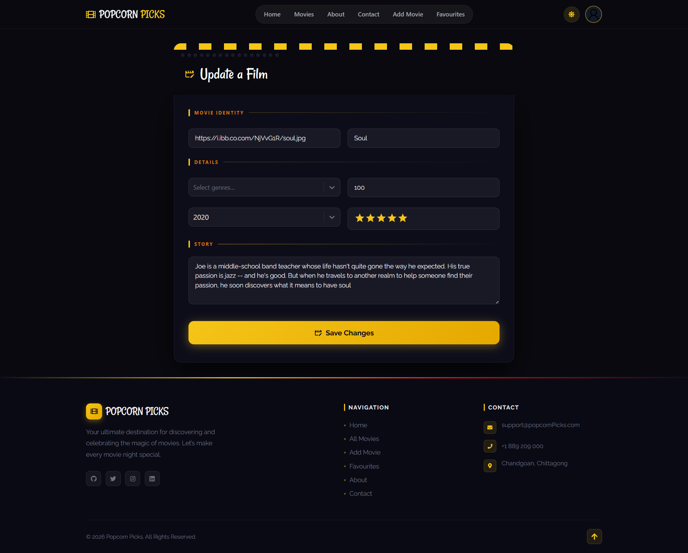
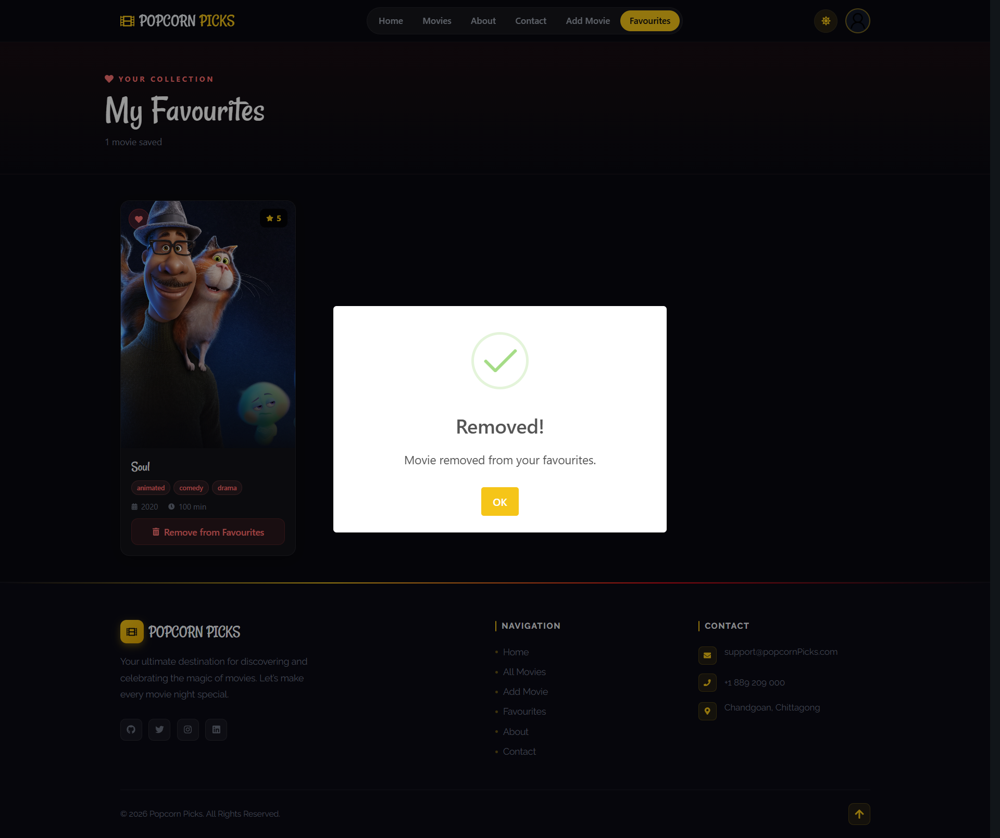

# 🍿 Popcorn Picks

**Popcorn Picks** is a movie portal featuring a variety of features and an updated design. With an easy-to-use interface with responsive design and fluid animations, users can find, search, and manage their favorite films.

## Website Preview

### Homepage


### Movies page


### Form pages



### Remove Movie from Favorites


## Live Demo

### [Visit the Live Site](https://popcorn-picks-movies-portal.web.app/)


## Key Highlights
* **Responsive Design** 
* **Fast Performance**
* **Beautiful UI** 
* **Secure Authentication**
* **Persistent Data** 


## Features

* **Top Rated Movies:**  Browse the 6 highest-rated movies section
* **Interactive Cards:**  Movie cards with smooth hover animations and transitions 
* **Search & Filter:**  search functionality to find movies by title 
* **Trending Section:**  Dynamic trending movies updated in real-time 
* **Movie Details:**  Comprehensive movie information pages with synopsis and ratings 
* **Watchlist:**  Save and manage your favorite movies in a personalized collection 
* **User Authentication:**  Secure login/signup with Firebase 
* **Star Rating:**  Interactive rating system for movies 
* **Newsletter:**  Subscribe to updates and promotions 
* **Dark/Light Mode:**  Theme switcher for comfortable viewing 


## Tech Stack

* Frontend: Vite, Tailwind CSS, DaisyUI, Firebase
* Backend: Express.js, Node.js, MongoDB, CORS
* Authentication and Hosting: Firebase and Vercel
* Additional Libraries: React Router DOM, React Icons, React Toastify, SweetAlert2, Swiper.js, React Simple Star Rating

### Basic Workflow

1. **Browse Movies**
   - Visit the homepage to see featured and trending movies
   - Use the search bar to find specific movies from the allMovies page

2. **View Movie Details**
   - Click on any movie card to see full details
   - Read synopsis, ratings, and additional information
   - Also Update the information

3. **Create Account**
   - Sign up with email or existing credentials
   - Secure authentication via Firebase

4. **Manage Favorites**
   - Add movies to your watchlist
   - Remove or manage favorites from the "My Favorites" page

5. **Add New Movies** (Admin/Authenticated Users)
   - Navigate to "Add Movies" section
   - Fill in movie details and submit
   - Movies appear immediately on the portal


##  Related Repositories
- **Backend-Repository:** [Popcorn Picks Server](https://github.com/noor00111/Popcorn-Picks-Server)
- **Purpose:** Express.js API server with MongoDB integration
- **Technology:** Node.js, Express, MongoDB, CORS


##  Getting Started

### Prerequisites
- Node.js (v16 or higher)
- npm or yarn package manager
- Git

### Installation

1. **Clone the repository**
   ```bash
   git clone https://github.com/noor00111/Popcorn-Picks.git
   cd popcorn-picks-client
   ```

2. **Install dependencies**
   ```bash
   npm install
   ```

3. **Set up environment variables**
   - Create a `.env.local` file in the root directory
   - Add your Firebase configuration credentials:
   ```env
   VITE_FIREBASE_API_KEY=your_api_key
   VITE_FIREBASE_AUTH_DOMAIN=your_auth_domain
   VITE_FIREBASE_PROJECT_ID=your_project_id
   VITE_FIREBASE_STORAGE_BUCKET=your_storage_bucket
   VITE_FIREBASE_MESSAGING_SENDER_ID=your_sender_id
   VITE_FIREBASE_APP_ID=your_app_id
   ```

4. **Start the development server**
   ```bash
   npm run dev
   ```
   The application will open at `http://localhost:5173`

---

## Contributing Contributions are welcome!
